# 8x8x8 LED cube on an STM32F746 with a serial-linked 3D simulator

Register-level firmware for a NUCLEO-F746ZG board that multiplexes a 512-LED cube, switches between five animations with a push button on an external interrupt, writes to a character LCD and accepts live frames from a 3D simulator running in the browser.

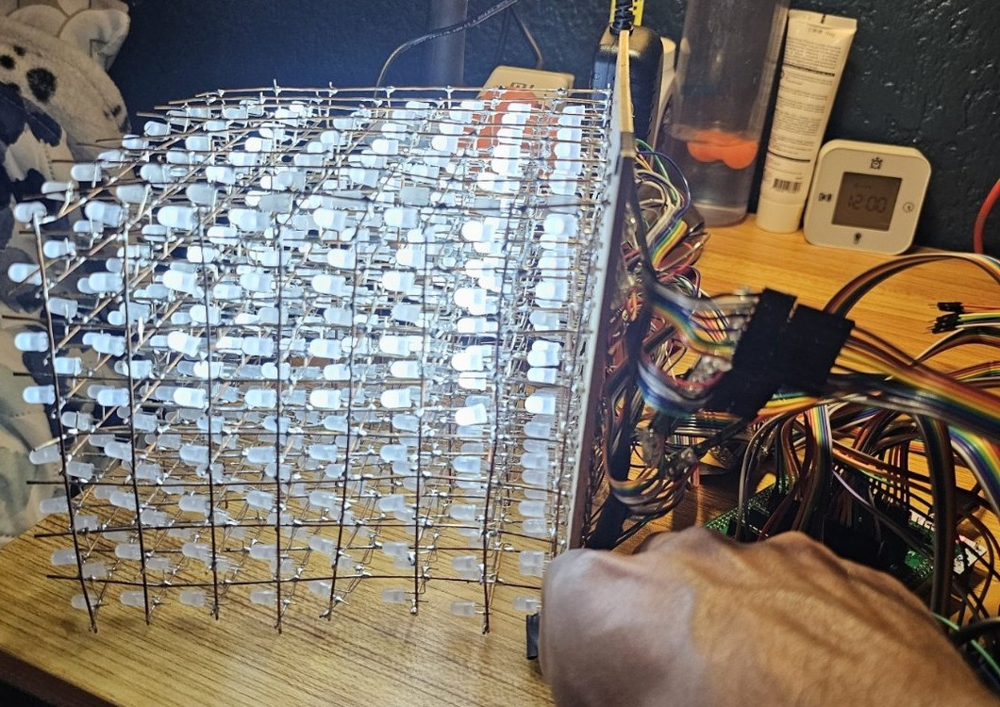

[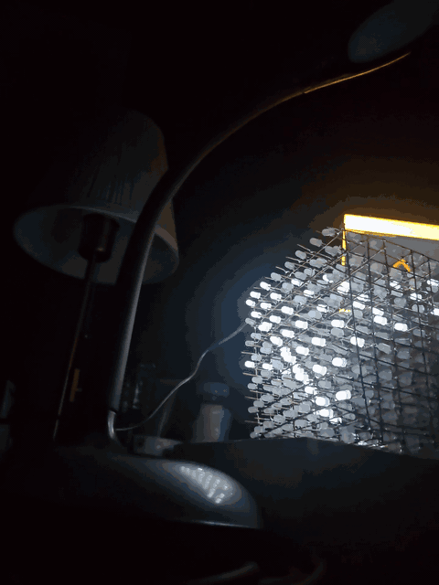](media/led-cube-demo.mp4)

Bench recording (2 min 28 s, no audio; click the preview for the MP4): the cube lights up moving planes and other patterns while the browser simulator runs on the monitor behind it; between about 0:25 and 0:32 the simulator panel reads "Cubo en vivo · 10 tramas/s · 0 con error" (cube live, 10 frames per second, 0 with errors).

## Problem / context

First assignment of the **Embedded Systems** course, Universidad ECCI (Bogotá), 2026, professor **Fabián Barrera Prieto**. The brief asked for an 8x8x8 light-emitting diode (LED) cube with five animations, switched by a push button configured as an external interrupt, and a liquid-crystal display (LCD) showing the name of the active animation. The course tool is Keil µVision, programming the microcontroller registers directly, without hardware abstraction layer (HAL) libraries.

The underlying problem is electrical. An STM32 pin delivers 3.3 V and at most 25 mA, while a full layer of 64 LEDs at about 10 mA each needs around 640 mA. The LEDs therefore do not hang from the pins: a power stage with its own 5 V supply drives them, and the firmware only decides which transistors conduct at each instant.

Beyond the brief, I wrote a browser-based 3D simulator with the same animations and a two-way serial link, so the physical cube can show live what the simulator draws.

## How it works

### Architecture

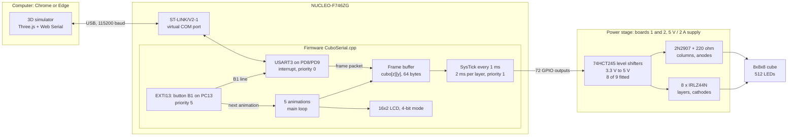

### Hardware

| Block | Components | Role |
|---|---|---|
| Board | NUCLEO-F746ZG (STM32F746ZGT6, Arm Cortex-M7 core) | Runs the firmware from the 16 MHz high-speed internal oscillator (HSI), without the phase-locked loop (PLL). |
| Breakout board | Adapter that regroups the morpho headers by port | Brings the 80 pins in use (64 columns, 8 layers, 6 for the LCD and 2 grounds) out to the cables. It must be **soldered** to the Nucleo (see Debugging). |
| Level shifting | 74HCT245 octal buffers: 9 sockets (8 column banks + 1 layer bank), **8 chips fitted** | HCT parts accept 2 V as a logic "1", so they translate 3.3 V to 5 V. A 74HC245 at 5 V would need 3.15 V and would sit at the limit. The chip for bank 4 of board 2 (row y=7) was never obtained. |
| Columns | 2N2907 PNP bipolar transistors, base through 3.9 kΩ, collector through 220 Ω | Emitter at 5 V. A column (anodes) turns on when the microcontroller pin is **0**. |
| Layers | 8 × IRLZ44N logic-level metal-oxide-semiconductor field-effect transistors (MOSFET) | Drain to the layer cathodes, source to ground. A layer conducts when its pin is **1**. |
| Power | 5 V / 2 A supply through a barrel jack on board 1 | Ground shared with the Nucleo. The Nucleo is powered from its USB port (jumper JP3 on U5V). |
| Display | 16x2 HD44780 LCD in 4-bit mode, write-only (RW tied to ground), 10 kΩ contrast potentiometer | Shows `SECUENCIA n/5` and the animation name. |
| Cube | 512 diffused white LEDs: 64 columns × 8 layers | Leaves the base as 8 ribbons of 8 wires (one per row y) and 8 ground wires (one per layer z). |

The power stage is soldered on two perfboards ("baquelas" in the Spanish files). Board 1 holds the column banks for rows y0 to y3, the layer bank, the 8 MOSFETs and the jack; board 2 holds the column banks for rows y4 to y7. The full map, with the orientation of every chip and transistor, is in [`docs/contrato_pines.md`](docs/contrato_pines.md) (in Spanish).

### Firmware

- **Frame buffer.** `cubo[z][y]` is an 8 × 8 byte array; bit `x` of each byte is the column. Animations only draw on a canvas and copy it into this buffer; they never touch the pins.
- **SysTick scan.** The core timer interrupts every 1 ms (`SysTick_Config(16000)` at 16 MHz). Every 2 ms the handler turns off the current layer, builds the 64 column masks per port and writes them with **a single write to `BSRR` per port** (atomic, it does not disturb other pins), then turns on the next layer. Turning the layer off before changing the columns avoids "ghosting" from the previous layer. 8 layers × 2 ms = 16 ms per pass, about 62 Hz.
- **Five animations**, one frame every 140 ms: PLANOS (a plane sweeping the three axes), LLUVIA (rain), CUBO (a shell that grows and shrinks), ESPIRAL (spiral) and ONDA (a diagonal sine surface). They are the same code shown in the simulator's "Código" tab.
- **Button B1 on an external interrupt** (line 13 of the external interrupt controller, EXTI, rising edge). Debouncing uses a timestamp: anything within 200 ms of a valid press is ignored, with no delays inside the handler. The handler only changes the index and raises a flag; the main loop aborts the running animation and starts the new one.
- **Priorities** in the nested vectored interrupt controller (NVIC): USART3 = 0, SysTick = 1, EXTI = 5. The F746 USART3 holds a single received byte and at 115200 baud one arrives every 87 µs, so its handler cannot wait for the scan to finish; in turn the scan must not be delayed by the button.
- **LCD.** It is re-initialised every 2.5 s during the first 20 s after reset, so it does not matter whether the 5 V supply comes up after the USB.
- **Wiring test mode.** Holding B1 at reset walks through the x columns, the y rows and the z layers, one plane every 700 ms, with the index shown on the board LEDs and on the LCD. It is meant to find a ribbon or ground wire in the wrong order; the fix goes into the tables `COL_PUERTO`, `COL_PIN`, `PISO_PUERTO` and `PISO_PIN`, not into the hardware.

#### Serial link with the simulator (`CuboSerial.cpp`)

The universal synchronous/asynchronous receiver-transmitter USART3 is wired on the Nucleo to the ST-LINK debugger, so it travels over the same programming USB cable as a virtual COM port: nothing extra to wire. 115200 baud, 8 data bits, no parity, 1 stop bit.

| Direction | Format | Length |
|---|---|---|
| PC → cube, frame | `A5 5A 01` + 64 bytes (`cubo[0][0..7]` … `cubo[7][0..7]`) + XOR | 68 bytes |
| PC → cube, text | `A5 5A 02` + animation number + 32 LCD characters + XOR | 37 bytes |
| Cube → PC | Text lines: `CUBO LISTO` at start-up, `B1` on each press, `ESTADO VIVO\|LOCAL good bad` every second | variable |

The XOR (exclusive-or checksum) runs from the type byte to the last data byte. Reception is a state machine inside the interrupt: if more than 5 ms pass without bytes in the middle of a packet, it is dropped and the receiver waits for a new `A5 5A`; overrun, framing and noise errors are cleared in `ICR` so the handler does not re-enter endlessly. Transmission uses a 128-byte ring buffer emptied by the transmit-register-empty interrupt; it never blocks. If no frame arrives for 1 s, the cube falls back to its own animations.

### Pin and register map

Taken from [`firmware/CuboSerial.cpp`](firmware/CuboSerial.cpp).

| Function | Pins | Configuration |
|---|---|---|
| Columns, rows y0 to y3 (board 1) | y0: PD0–PD7 · y1: PG0–PG5, PG8, PG9 · y2: PC6–PC12, PB15 · y3: PB1–PB6, PB10, PB11 | Push-pull output, medium speed, no internal pull resistors. Active low. |
| Columns, rows y4 to y7 (board 2) | y4: PE0–PE7 · y5: PE8–PE15 · y6: PF0–PF7 · y7: PF8–PF15 | Same as above. Row y7 has no 74HCT245 fitted (see Results). |
| Layers z0 (bottom) to z7 (top) | PG12, PG10, PD15, PD14, PD13, PD12, PD11, PD10 | Push-pull output. Active high. z0 goes to MOSFET 8 and z7 to MOSFET 1. |
| LCD | RS PA4 · E PA15 · D4 PB12 · D5 PG14 · D6 PG15 · D7 PA6 | Outputs; RW tied to ground. |
| Board LEDs | LD1 PB0 · LD2 PB7 · LD3 PB14 | Outputs; animation number in binary. |
| Button B1 | PC13 | Input with internal pull-down (gives 3.3 V when pressed). |
| USART3 | PD8 = TX · PD9 = RX | Alternate function 7; internal pull-up to 3.3 V on RX. |

| Peripheral | Registers and values |
|---|---|
| Clocks (reset and clock control, RCC) | `AHB1ENR` bits 0–6 (ports A to G) · `APB2ENR` bit 14 (SYSCFG) · `APB1ENR` bit 18 (`USART3EN`) |
| General-purpose input/output (GPIO) | `MODER` (01 output, 10 alternate function) · `OTYPER` · `OSPEEDR` (01) · `PUPDR` (10 on PC13, 01 on PD9) · `AFR[1]` (7 on PD8 and PD9) · `BSRR` to write · `IDR` to read B1 |
| Timer | **SysTick** only (`SysTick_Config(16000)`, 1 ms). The TIMx timers are not used: the scan needs a fixed time base and SysTick is enough. |
| External interrupt | `SYSCFG->EXTICR[3]` bits 7:4 = 0010 (port C) · `EXTI->IMR`, `RTSR` (rising edge) and `FTSR` on bit 13 · `EXTI->PR = (1<<13)` with `=` rather than `\|=` so other pending flags are not cleared · vector `EXTI15_10_IRQHandler` |
| USART3 | `BRR = 139` (16 MHz / 115200 = 138.9, 0.08 % error) · `CR1` = `TE \| RE \| RXNEIE`, then `UE`; `TXEIE` is enabled only while the queue has data · `ISR` (`RXNE`, `TXE`, `ORE`, `FE`, `NE`) · `ICR` · `RDR` · `TDR` · vector `USART3_IRQHandler` |
| NVIC | `USART3_IRQn` priority 0 · `SysTick_IRQn` priority 1 · `EXTI15_10_IRQn` priority 5 |

### Simulator

[`simulador/simulador_cubo_8x8x8.html`](simulador/simulador_cubo_8x8x8.html) is a single HTML file (user interface in Spanish). It draws the cube with Three.js, includes the five course animations with the same code as the firmware plus eight more (TOCAR, a keyboard-playable SNAKE, PENDULO, FUEGO, ESFERA, HELICE, ECCI and DIBUJAR), a virtual LCD and a **Cables** tab that tells, for each LED, which ribbon, board, bank and pin it goes to. The **Conectar cubo** button opens the port with the Web Serial API (filtering on the ST-LINK USB vendor ID 0x0483), sends the frame and the LCD text on every animation step and receives presses of the physical B1. A set of orientation check boxes (swap x and y, flip x, y or z) transforms only the frame that is sent, to align the on-screen view with the real cube.

### Repository layout

```
firmware/
  CuboSerial.cpp          final firmware: five animations, LCD, B1 and serial link to the simulator
  CuboLed8x8x8.cpp        the same firmware without the serial link (submitted version, with the layer order fixed)
  pruebas/                diagnostic firmwares used while debugging
    PruebaEstatica.cpp    fixed levels that can be measured with a multimeter (one LED, one row, one column...)
    PruebaPisos.cpp       one full layer at a time, no multiplexing
    PruebaApagado.cpp     a layer on with all columns off: reveals a bank that does not switch off
    PruebaLCD.cpp         display only, retrying initialisation every 2 s
    PruebaF746ZG.cpp      first board test (LEDs, button and external interrupt)
  variantes/
    CuboTresPisos.cpp     five animations meant to run on three layers only
    CuboVivo.cpp          five animations with a live layer selector (long press)
  gcc/
    build.sh              build with arm-none-eabi-gcc
    STM32F746ZGTx_FLASH.ld  linker script: 1 MB flash, 320 KB RAM
simulador/simulador_cubo_8x8x8.html
media/
  led-cube-demo.mp4       bench video, no audio
  led-cube-preview.gif    5-second preview
docs/
  bitacora.md             integration and debugging log with measurements (in Spanish)
  contrato_pines.md       pin map, 74HCT245 pinout, LCD, power (in Spanish)
  verificacion_baquelas.md  step-by-step verification procedure for the boards (in Spanish)
  fotos/
```

File names and code comments are in Spanish, as they were written during the course. The variants in `firmware/variantes/` and some of `firmware/pruebas/` were written while only two or three layers responded; they remain as a record of how the fault was worked around while its cause was being found.

### Build photos

| | |
|---|---|
| 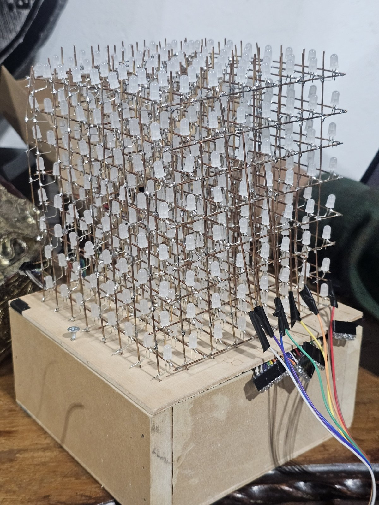 | 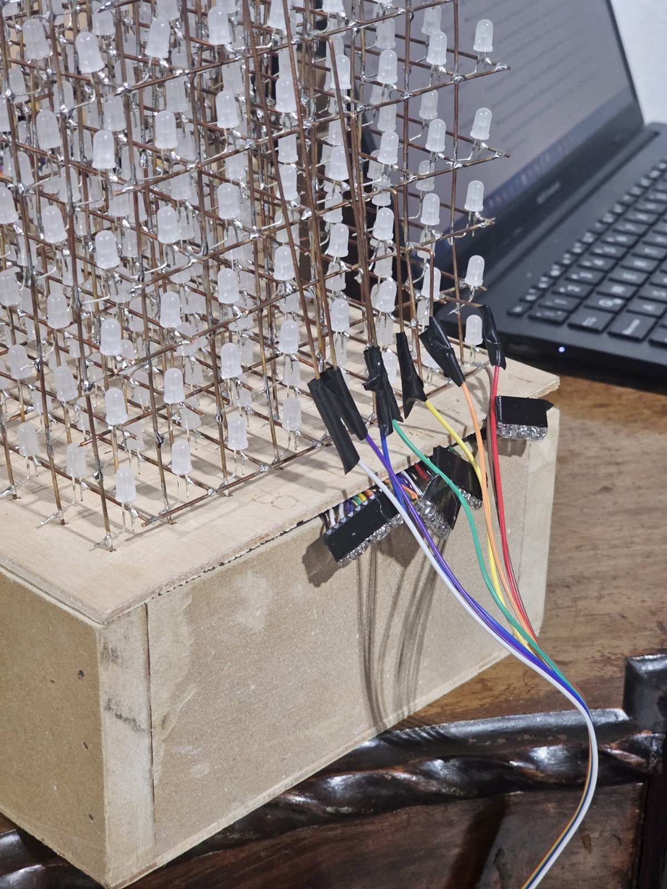 |
| Cube structure | Layer grounds and column ribbons |
| 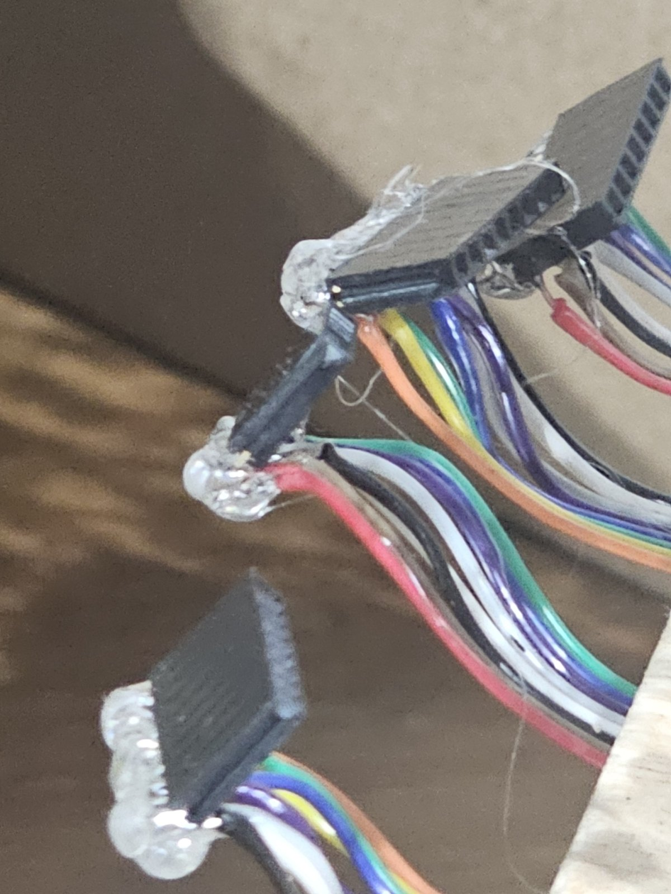 | 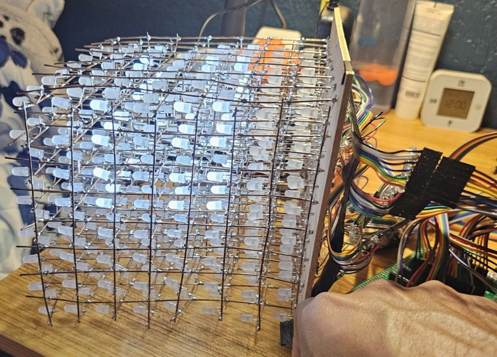 |
| Connectors of the 8-wire ribbons | Cube lit |
| 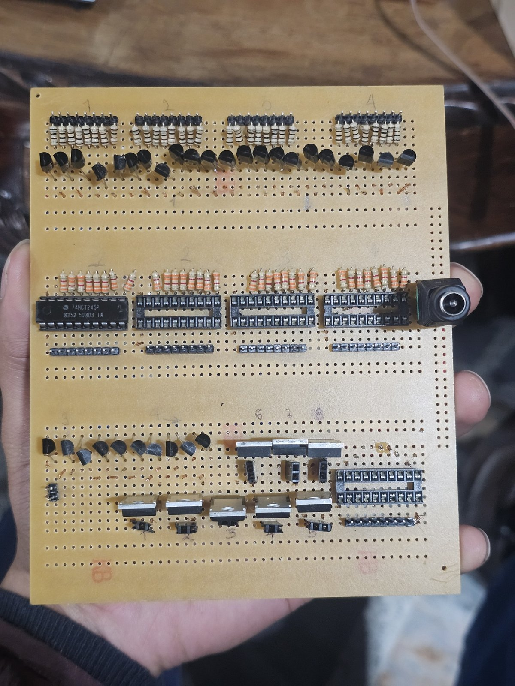 | 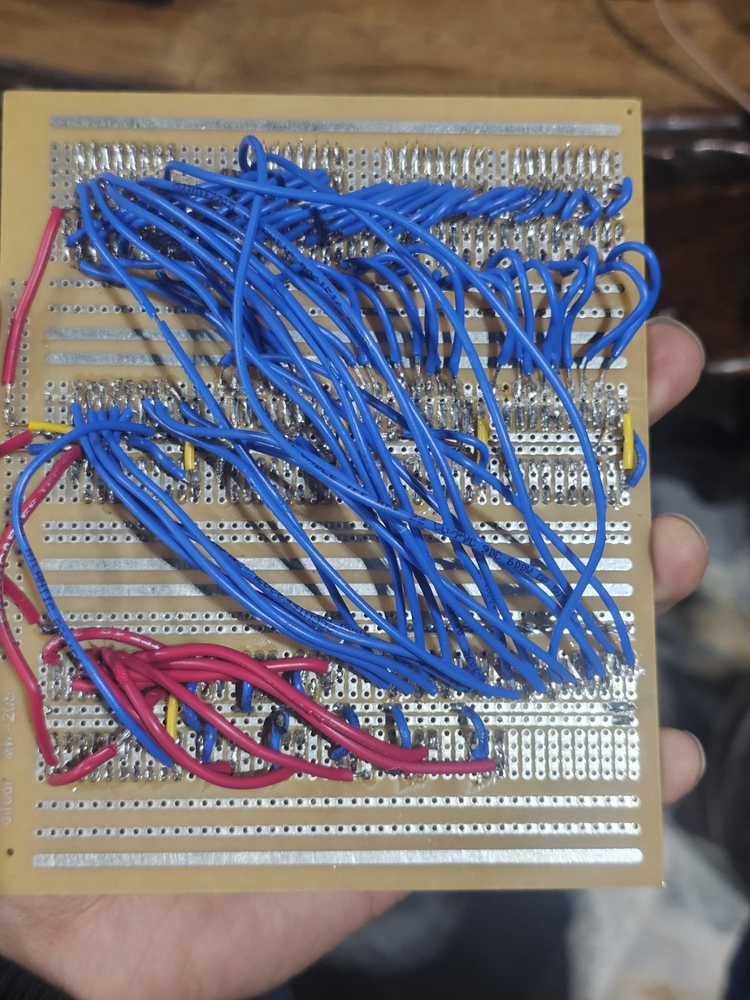 |
| Board 1: 4 column banks, layer bank, 8 MOSFETs and jack | Board 1, underside |
| 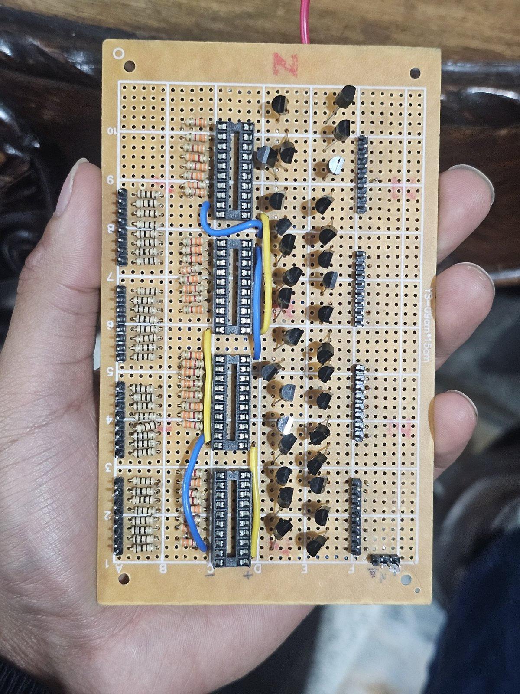 | 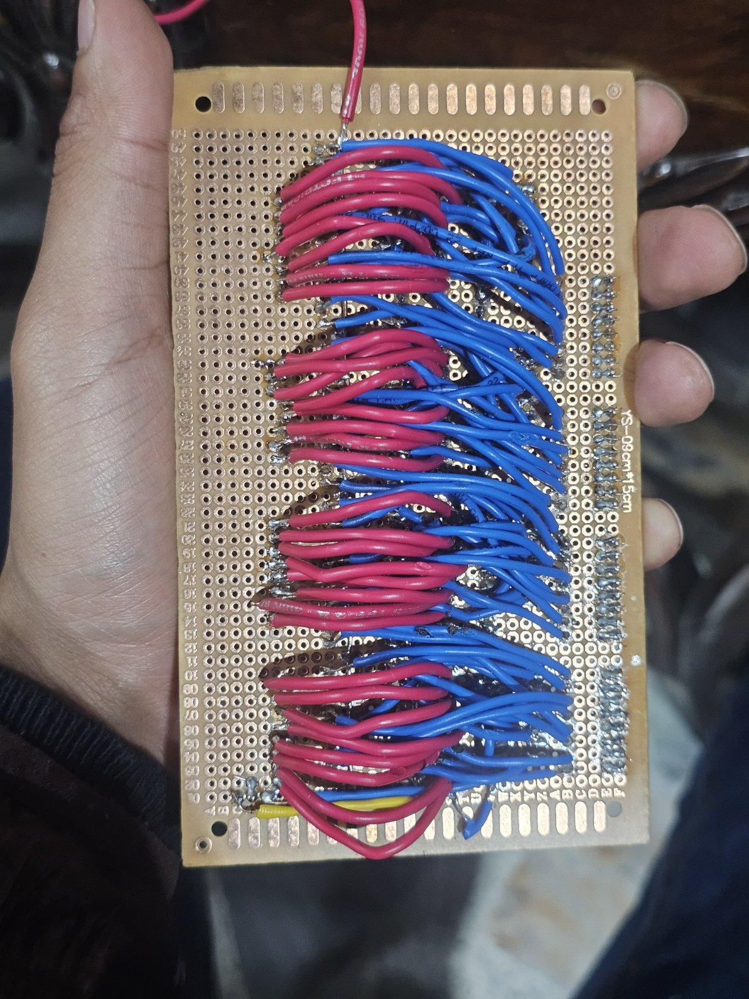 |
| Board 2: column banks for rows y4 to y7 | Board 2, underside |

## Results and measurements

Everything below comes from [`docs/bitacora.md`](docs/bitacora.md) (in Spanish), from the code and from the video; there are no additional lab measurements.

- **Animations:** after the morpho pins were soldered, the cube ran all five animations (planes along x, y and z, rain, cube, spiral and wave).
- **Missing row y=7:** the 74HCT245 for bank 4 of board 2 was never obtained. Row y=7 (pins PF8–PF15) has no driver, so that vertical x-z plane of 64 LEDs (8 columns × 8 layers) never lit. At most 448 of the 512 LEDs could be driven, and every layer was missing its last row. The animations ran with that gap.
- **Row y=2 that does not switch off:** on board 1, bank 3 (row y=2) stays lit whenever all of its columns x0..x6 are off; the diagnosis points to pin 9 (A8) of that chip not receiving 0 V (see Debugging, item 4). The log leaves this fault open.
- **Not verified as complete:** the log does not record an LED-by-LED check of all eight layers after the fixes, so this repository does not claim that the eight layers and eight rows worked in full.
- **LCD:** during integration it showed the black boxes of the first line but did not initialise; it worked after the wiring was corrected. The corrected wiring is not documented.
- **Serial link:** `CuboSerial.cpp` compiled in Keil with 0 errors and 0 warnings, and the protocol was cross-checked in software before flashing. On the board, with the simulator connected, the cube showed the ECCI animation sent from the browser, but rotated or mirrored with respect to the front view; the orientation check boxes were added for that. In the video, the simulator panel reports "10 tramas/s · 0 con error" (10 frames per second, 0 with errors) while connected.
- **Refresh rate:** 62 Hz by design (2 ms per layer × 8 layers), calculated from the code, not measured with an instrument.
- **LED current:** the reference design calculates about 10 mA from (5 V − 3.1 V) / 190 Ω; the boards were fitted with 220 Ω, so the real current is somewhat lower. It was not measured.
- **Simulator:** SNAKE was tested in the browser at 60 frames per second with 385 ms per step (configured as 378 ms).

## Debugging

The full log is in [`docs/bitacora.md`](docs/bitacora.md) (in Spanish). The most useful points, in order:

1. **The cube was ruled out first.** The first integration lit no LED at all. Before touching the firmware, the cube was tested on its own with a 9 V battery in series with 180 Ω: positive on a column wire, negative on a layer wire. One LED lit, and moving the negative through the 8 ground wires moved the LED up and down layer by layer. Conclusion: correct polarity (anodes on columns, cathodes on layers) and grounds in order.
2. **Cause 1: the MOSFET sources were floating.** With board 1 powered and the inputs forced with jumpers, without the Nucleo: pins 20 and 1 of the 74HCT245s = **5.1 V**, pins 10 and 19 = **0 V** (chip supply fine). On MOSFET 1: gate **5 V**, drain **2.9 V**, source **2.9 V**. A source at 2.9 V instead of 0 V means the common source track did not reach the jack's negative terminal. With a jumper from that track to the negative terminal, LED (x0, y0, z0) lit steadily.
3. **Cause 2, the root of almost everything else: the morpho pins were not soldered.** The breakout board was only resting on the headers. Random LEDs appeared and no state was fully dark: the 74HCT245 inputs were left open, and an unconnected CMOS (complementary metal-oxide-semiconductor) input floats, picks up noise and its output toggles on its own. After soldering the 80 morpho pins, the cube ran the five animations.
4. **A row that does not switch off.** An x-z plane (row y=2) appeared permanently lit. `PruebaPisos` could not show it because it never leaves a layer on with its columns off, so `PruebaApagado` was written. Result: the row switched off as soon as any of PC6–PC12 went to 0 V, and lit again when only PB15 (x7) was at 0 V. The firmware writes each bit separately and cannot make one column depend on another, so the fault is in the bank 3 chip: its pin 9 (A8) does not receive the 0 V. Pins 9 and 10 (ground) are neighbours in the socket.
5. **Layers upside down.** With `CuboSerial` the rain went upwards: MOSFET 1 is the top layer, not the bottom one. It was fixed in the `PISO_PUERTO` and `PISO_PIN` tables of every firmware, in the simulator and in the pin map, without touching a single wire.
6. **"It works better without the supply."** Without the 5 V supply, the STM32 pins sitting at 3.3 V (columns off) feed the boards' 5 V rail through the input protection diodes of the 74HCT245s. On that weak rail, emitter and output drop together and the fault is hidden; with the supply, the emitters are held at 5 V and an output that cannot hold about 4.5 V lets the transistor conduct. **The supply was not the cause; it was what made the fault visible.** Hence the power-up rule: supply first, USB second.

## How to reproduce

### Build with Keil µVision

The µVision project file (`.uvprojx`) used on the bench is not available, so it is not included. These steps create an equivalent one:

1. Install Keil MDK (µVision 5.34 with Arm Compiler 6.16 was used) and the device pack `Keil::STM32F7xx_DFP`.
2. *Project → New µVision Project*, device **STM32F746ZGTx**.
3. In *Manage Run-Time Environment* tick **CMSIS → CORE** and **Device → Startup** (they add the vector table and `SystemInit` from the Cortex Microcontroller Software Interface Standard, CMSIS).
4. Add a single `.cpp` to the source group, for example `firmware/CuboSerial.cpp`. Every file in `firmware/` is a complete program with its own `main`.
5. *Options for Target*: Arm Compiler 6, optimisation `-O1`, *Create HEX File* in the *Output* tab. In *Debug*: ST-Link Debugger, SW port, *Connect: Under Reset*; in *Flash Download*: algorithm `STM32F7x_1024` and *Reset and Run*.
6. *Rebuild* (F7). It should end with `0 Error(s), 0 Warning(s)`.

### Build with arm-none-eabi-gcc

[`firmware/gcc/build.sh`](firmware/gcc/build.sh) builds any `.cpp` in the repository. It needs `gcc-arm-none-eabi` and STMicroelectronics' CMSIS repositories, which are not included here (Apache 2.0 license):

```bash
cd firmware/gcc
git clone --depth 1 https://github.com/STMicroelectronics/cmsis_device_f7.git cmsis/dev
git clone --depth 1 https://github.com/STMicroelectronics/cmsis_core.git      cmsis/core
./build.sh ../CuboSerial.cpp        # produces build/CuboSerial.bin and build/CuboSerial.hex
```

The binaries that ran on the cube were built with Keil; the gcc path was not re-verified for this publication.

### Flash the board

- **Drag and drop:** connect the NUCLEO-F746ZG over USB on CN1 (the ST-LINK side), jumper JP3 on U5V. A drive named `NODE_F746ZG` appears; copy the `.bin` onto it and the board reprograms and restarts by itself. If a `FAIL.TXT` appears, read it.
- **From Keil:** *Download* (F8).

### Wire and power up

1. Wire according to [`docs/contrato_pines.md`](docs/contrato_pines.md) (in Spanish). Always tie the boards' ground to the Nucleo ground.
2. **Switch on the 5 V supply first and the USB second; when switching off, USB first.** Never leave the cube running without the supply (see Debugging, item 6).
3. At start-up the whole cube lights for 1 s (lamp test) and then runs animation 1. Each B1 press moves to the next; the number appears in binary on LD1 to LD3 and the name on the LCD.
4. If something does not match, start with B1 held (wiring test mode) or flash the programs in `firmware/pruebas/` in the order described in [`docs/verificacion_baquelas.md`](docs/verificacion_baquelas.md) (in Spanish).

### Simulator

1. Open `simulador/simulador_cubo_8x8x8.html` in desktop Chrome or Edge (Web Serial does not exist in Firefox or Safari). It works as a local file; it needs internet access the first time to load Three.js.
2. With `CuboSerial` flashed, press **Conectar cubo** and choose the ST-LINK port. Close any other program that has that COM port open first.
3. Adjust the orientation check boxes until the letters of the ECCI animation read the same on screen and on the cube.

## What I learned and what is missing

- **Measure before wiring more.** The two real causes (floating MOSFET sources and the unsoldered morpho headers) came out of multimeter measurements along a ladder of tests from the smallest to the largest, not from changing code. Every firmware in `pruebas/` exists to hold a fixed, measurable state.
- **A test program only sees what its pattern exercises.** `PruebaPisos` "worked perfectly" and yet a bank did not switch off; a different pattern was needed to see it.
- **Pin tables as the single source of truth.** Fixing the inverted layers without soldering anything was possible because the whole mapping lives in four tables.
- **A supply that "fixes" a problem can be hiding it**, as happened with the protection diodes.

What is missing:

- **Fit the missing 74HCT245** in bank 4 of board 2 so that row y=7 (64 LEDs) works; until then only 7 of the 8 rows can light.
- Close the bank 3 fault on board 1 (row y=2, pin 9 of the 74HCT245): continuity and measurements are still pending.
- Rule out latch-up or damage in any 74HCT245 from the time they ran with inputs above their supply.
- Check all eight layers and all rows LED by LED once the two items above are fixed.
- Move the correct orientation, currently set with the simulator check boxes, into the firmware tables.
- Document the wiring that made the LCD work.
- The scan runs inside the SysTick interrupt with 64 iterations per layer; a hardware timer with direct memory access (DMA) could free the processor, but it was not needed at 16 MHz.

## Credits

- **Javier Solís:** firmware, debugging, web simulator, measurements.
- **William Uriza:** soldering of the cube and the power boards.

Course: Embedded Systems, Universidad ECCI, 2026, professor Fabián Barrera Prieto. The power stage (74HCT245, 2N2907 and IRLZ44N with an external 5 V supply) follows the reference design proposed in the course.

The simulator loads [Three.js](https://threejs.org/) r128 from cdnjs, under the MIT license. The gcc build uses the CMSIS files from STMicroelectronics and Arm (Apache 2.0), which are downloaded separately and are not part of this repository.

### On AI assistance

Parts of the code and documentation were written with the help of AI assistants (Claude); in particular, the firmware and the browser simulator were written with that help. The assembly of the cube and the power boards and the bench debugging with multimeter measurements were done by Javier Solís and William Uriza, and I reviewed everything published here.

## License

- **Code** (`firmware/`, `simulador/`): MIT License, see [`LICENSE`](LICENSE).
- **Photos, video and documentation** (`docs/`, including `docs/fotos/`, `media/` and this README): Creative Commons Attribution 4.0 International, see [`LICENSE-docs`](LICENSE-docs).
